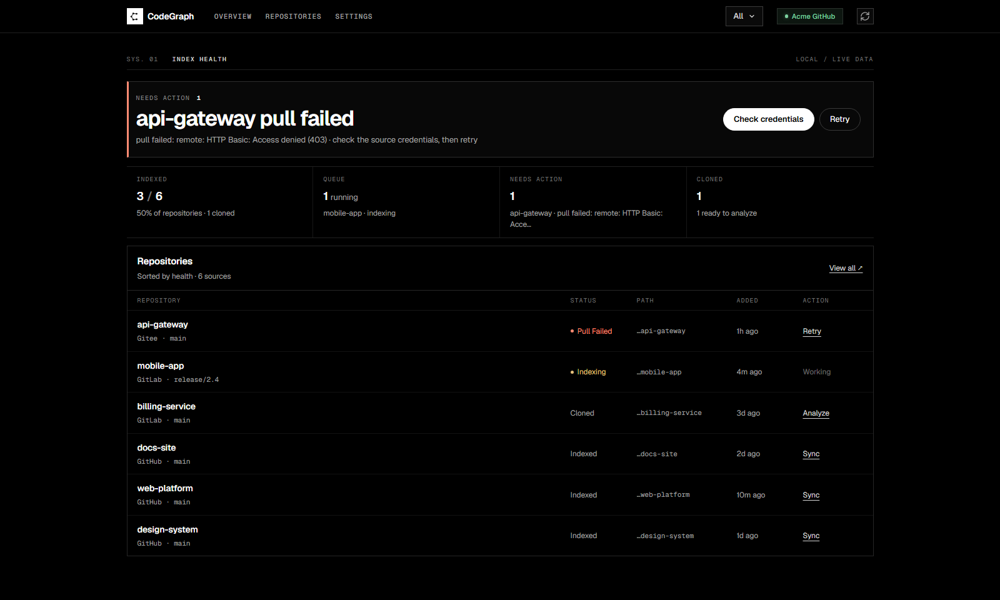
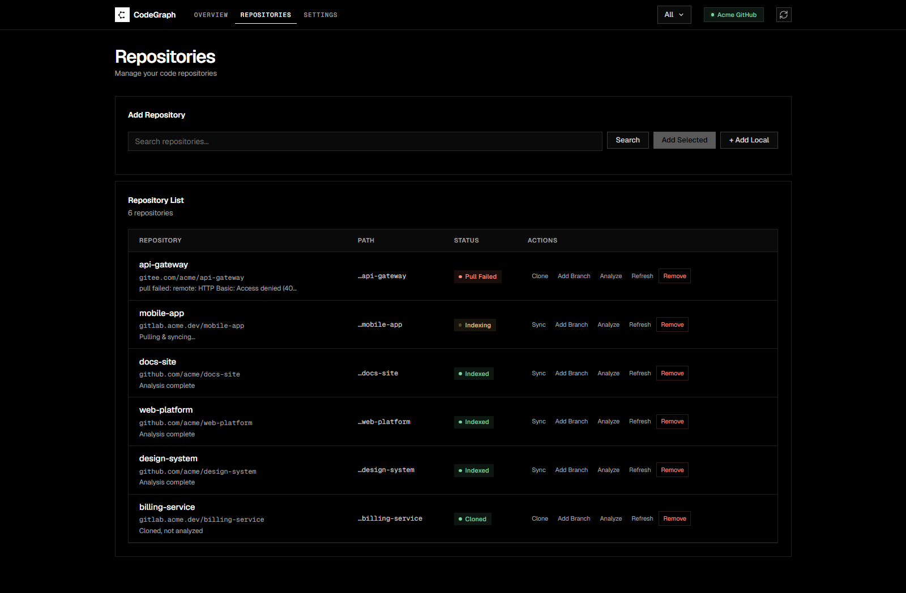
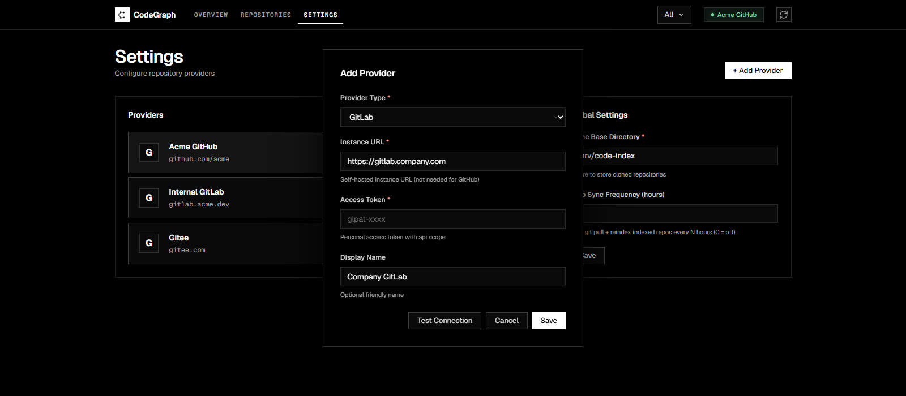
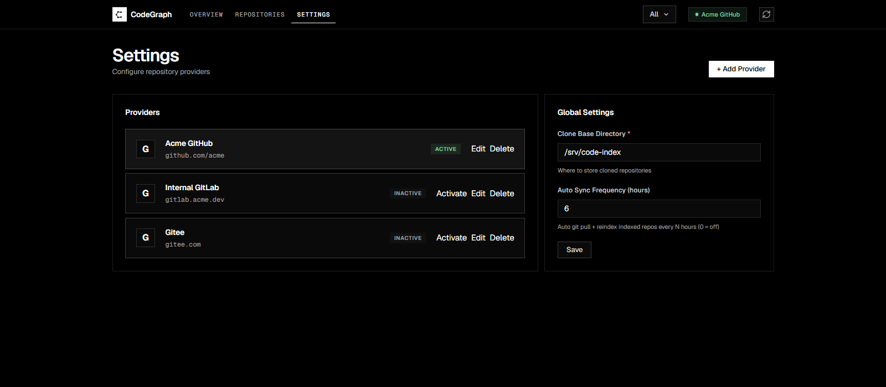

<div align="center">

# CodeGraph Manager

**Turn your entire codebase into a knowledge graph your AI can read.**

Manage repositories from GitLab / Gitee / GitHub in one place, build a code knowledge graph with [CodeGraph](https://github.com/colbymchenry/codegraph), and let AI agents like Cursor or Claude query your code directly over **MCP (Model Context Protocol)**.

[](https://nodejs.org)
[](#-dependencies)
[](#-license)
[](#-mcp-integration)

<a href="README.md">🇨🇳 中文</a> · 🇬🇧 English

</div>

---

Zero-dependency Node backend + single-file vanilla-JS frontend, **one command to start**: no database install, no build step, no Docker.
The whole pipeline — clone → index → AI retrieval — runs automatically. Tokens are encrypted at rest; all data lives in one directory.

## ✨ Features

**Repository management**
- Multi-provider — GitLab / Gitee / GitHub with multiple instances each; one cross-source query returns everything
- Full lifecycle — one-click `clone → analyze → sync → remove`; shallow clone is ~10x faster
- Local repos — register an already-cloned directory directly (auto-detects Git remote)
- Branch worktrees — lazily spin up an isolated worktree per branch with its own index, so AI can query any branch; the main index stays clean automatically
- Spaces — tag repos into groups and filter the UI by space
- Scheduled freshness — configurable auto `git pull + sync`; a failed pull is marked `pull_failed` instead of pretending the index is fresh

**AI retrieval (MCP)**
- 4 MCP tools (Streamable HTTP / JSON-RPC 2.0); cross-repo aggregated search — concurrent queries over all indexed repos, ranked hits with per-repo caps so your context window doesn't explode
- Querying a branch with no index yet? The server builds one in the background and returns "retry shortly"

**Security**
- Route-level auth — `/api/*` and `/mcp*` guarded by `ADMIN_TOKEN` / `MCP_TOKEN`, constant-time comparison
- Loopback exemption — local access allowed by default (with same-origin checks so web pages can't hit your localhost); fail-closed when exposed: refuses to start without a token
- Auto-generated 192-bit token on first start, persisted to `auth.json` — safe to expose without any manual setup
- Token protection, three layers — AES-256-GCM at rest, masked in API responses (dots + last 4), masked PUT values never overwrite real tokens
- 1 MB body limit (413), cross-origin requests always 401, `X-Forwarded-For` only trusted from configured proxies

**Engineering**
- SQLite storage (`node:sqlite`, zero npm dependencies) — transactional atomic writes; legacy JSON auto-migrates on first start
- Three-tier concurrency control — global index queue + per-repo lifecycle mutex + per-file write serialization
- Restart self-healing — interrupted in-flight states reset automatically; `CODEGRAPH_BIN` auto-detected (no manual config on Windows)
- SSE live status push with 30s polling fallback; `BASE_PATH` for reverse-proxy sub-path deployments
- Built-in regression suite `node verify-mcp.mjs` (49 assertions: protocol / auth / masking / concurrency / migration)

## 📸 Screenshots

| Overview | Repositories |
|---|---|
|  |  |

| Add provider | Settings |
|---|---|
|  |  |

> Screenshots use sample data (Acme), not real repositories.

## 🚀 Quick Start

**One-click install** (installs anything missing: Node → git → CodeGraph → cgm, skips what's already there):

```bash
bash install.sh --port 8801          # Linux / macOS
.\install.cmd --port 8801            # Windows (or double-click install.cmd)
```

**Manual install**:

```bash
npm i -g @colbymchenry/codegraph     # the only external dependency
npm i -g codegraph-manager           # or: npm i -g . inside this repo
cgm                                  # start from any directory
```

Open **http://127.0.0.1:8801** → Settings → add a provider → Add Selected → Clone & Analyze. Done.

> CLI precedence: flags > environment variables > defaults. `cgm --port 9000 --data /srv/cgm-data`

## 🔌 MCP Integration

MCP endpoint: `http://127.0.0.1:8801/mcp` (Streamable HTTP / JSON-RPC 2.0)

**Cursor / Claude Desktop / Cline** (standard `mcpServers` format, also shipped as `mcp-config.json`):

```json
{
  "mcpServers": {
    "cgm": {
      "url": "http://127.0.0.1:8801/mcp",
      "headers": { "Authorization": "Bearer <your-token>" }
    }
  }
}
```

> Local access is token-free by default, so `headers` is optional. Where does the token come from: the first-start log, or `<DATA_DIR>/auth.json` (`adminToken`); you can also set `ADMIN_TOKEN` explicitly. URL-only clients can fall back to `?token=<token>`.

### Tools

| Tool | Description |
|---|---|
| `query_repository(name)` | Look up a repo by name: local path / status / provider |
| `list_repositories(status?)` | List registered repos, filterable by status |
| `search_repositories(query)` | Fuzzy repo-name search |
| `search_code(query, repo?, branch?, maxFiles?)` | **The core search**: queries the CodeGraph knowledge graph for symbols / files / call relationships. Omit `repo` to aggregate across all indexed repos |

Branch-scoped query example:

```json
{"jsonrpc":"2.0","id":1,"method":"tools/call",
 "params":{"name":"search_code","arguments":{"query":"AuthService loginUser","repo":"tineco-nmp","branch":"dev_ibu","maxFiles":12}}}
```

## ⚙️ Configuration

| Variable | Default | Description |
|---|---|---|
| `PORT` / `HOST` | `8801` / `127.0.0.1` | Listen address; non-loopback `HOST` requires a token (refuses to start otherwise) |
| `DATA_DIR` | `<cwd>/data` | Data directory (`cgm.db`; cloned repos default to `<DATA_DIR>/repos`) |
| `ADMIN_TOKEN` | auto-generated | Token for `/api/*`; on first start a random one is generated into `auth.json` |
| `MCP_TOKEN` | falls back to `ADMIN_TOKEN` | Token for `/mcp*` (one variable is enough for personal use) |
| `LOCAL_NO_AUTH` | `1` | Loopback auth exemption; set `0` to require auth locally too |
| `BASE_PATH` | empty | Reverse-proxy sub-path (e.g. `/cgm` → endpoints under `/cgm/mcp`) |
| `MAX_BODY_BYTES` | `1048576` | Request body limit, over-limit returns 413 |
| `TRUSTED_PROXIES` | empty | Comma-separated trusted proxy IPs; `X-Forwarded-For` only honored from these |
| `CODEGRAPH_BIN` | auto-detected | CodeGraph executable (PATH probe → npm global shim → explicit) |
| `SYNC_HOURS` | `6` | Scheduled sync interval in hours, `0` disables; also configurable in Settings |
| `QUEUE_CONCURRENCY` | `2` | Index queue concurrency |
| `ENCRYPTION_KEY` | auto-generated `.key` | 64-char hex AES-256-GCM key |

## 🔒 Security Model

| Scenario | Behavior |
|---|---|
| Local 127.0.0.1 access | Token-free by default (dev-friendly); cross-origin web requests still get 401 |
| LAN / remote access | Token required (Bearer header / `?token=` / Cookie) |
| `HOST=0.0.0.0` with no token | Starts with an auto-generated random token; the log tells you where it is |
| Token exposure surface | Encrypted at rest + masked via API + printed to log once, on first start only |

`data/` is excluded by `.gitignore` — real tokens never enter version control. For public exposure, put Nginx + HTTPS in front (see [DEPLOY-Linux.md](DEPLOY-Linux.md)).

## 🔌 API Reference

| Endpoint | Methods | Description |
|---|---|---|
| `/healthz` | GET | Liveness probe (no auth) |
| `/api/settings` | GET/PUT | Global settings (tokens masked in responses) |
| `/api/providers[/...]` | GET/POST/PUT/DELETE | Provider CRUD + connection test + cross-source project search |
| `/api/repos[/local]` | GET/POST | Registry / add a local repo |
| `/api/repos/:id/{clone,analyze,status,remove,sync}` | POST | Per-repo ops (async; same-repo ops are automatically serialized) |
| `/api/repos/:id/worktree/:branch` | POST/DELETE | Create / remove a branch worktree |
| `/api/spaces[/...]` | GET/POST/PUT/DELETE | Space management / repo binding |
| `/api/browse?path=` | GET | Server-side directory browser (for adding local repos) |
| `/mcp` · `/mcp/message` | POST/GET | MCP endpoint (Streamable HTTP + SSE) |

## ❓ FAQ

<details>
<summary><b>codegraph ENOENT on startup?</b></summary>

On Windows the globally installed codegraph is a bash shim that can't be spawned directly. The service auto-detects it and rewrites it as `["node", "<shim>"]` — no manual `CODEGRAPH_BIN` needed on recent versions.
</details>

<details>
<summary><b>Frontend keeps returning 401 after I set ADMIN_TOKEN?</b></summary>

The page pops up a token prompt — paste the token there (stored in localStorage). Or clear the `cgm_token` localStorage key and re-enter.
</details>

<details>
<summary><b>Will I lose data?</b></summary>

Everything lives in one `<DATA_DIR>` (SQLite + keys + auth.json); backing up = copying the directory. Legacy JSON files auto-migrate on first start and are kept as `*.json.migrated-*` — delete `cgm.db*`, rename them back, and you've rolled back.
</details>

<details>
<summary><b>Search results feel stale?</b></summary>

Check the status column: `pull_failed` means the scheduled pull failed (retried next round). You can also hit Sync manually. Indexes are updated incrementally via CodeGraph sync.
</details>

## 🛠 Development

```bash
git clone https://github.com/Zhao-T-X/CGM.git && cd CGM
node server.mjs                # dev server (127.0.0.1:8801)
node verify-mcp.mjs            # regression suite: 49 assertions (protocol/auth/security/concurrency/migration)
```

```
codegraph-manager/
├── cli.mjs            CLI entry (the cgm command)
├── server.mjs         HTTP backend (route auth, providers/repos/spaces, SQLite persistence)
├── mcp.mjs            MCP module (4 tools + CodeGraph stdio gateway client)
├── verify-mcp.mjs     Regression suite (49 assertions, isolated temp instances)
├── public/index.html  Single-file frontend (Vercel-style dark UI)
└── install.sh/.cmd    One-click installers
```

## 🚢 Release (maintainers)

Pushing a `v*` tag triggers GitHub Actions to publish to npm (tag/version check → `npm pack --dry-run` → `npm publish --provenance`; requires the `NPM_TOKEN` secret).

```bash
npm version patch && git push --follow-tags
```

## 📄 License

MIT
