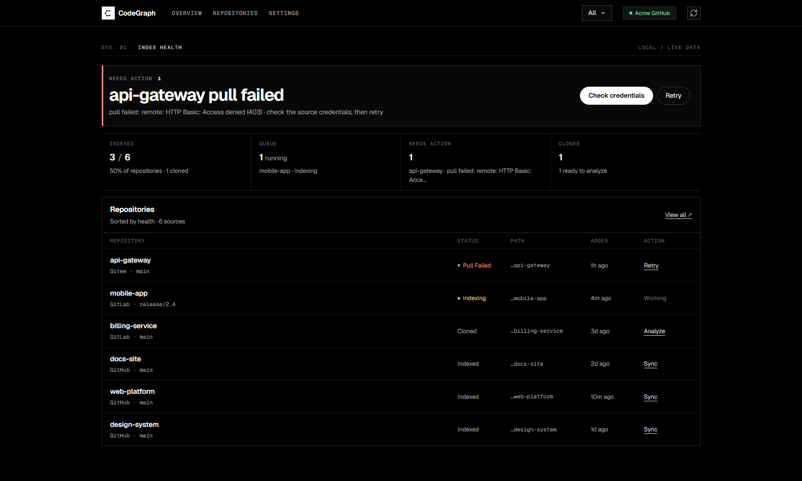
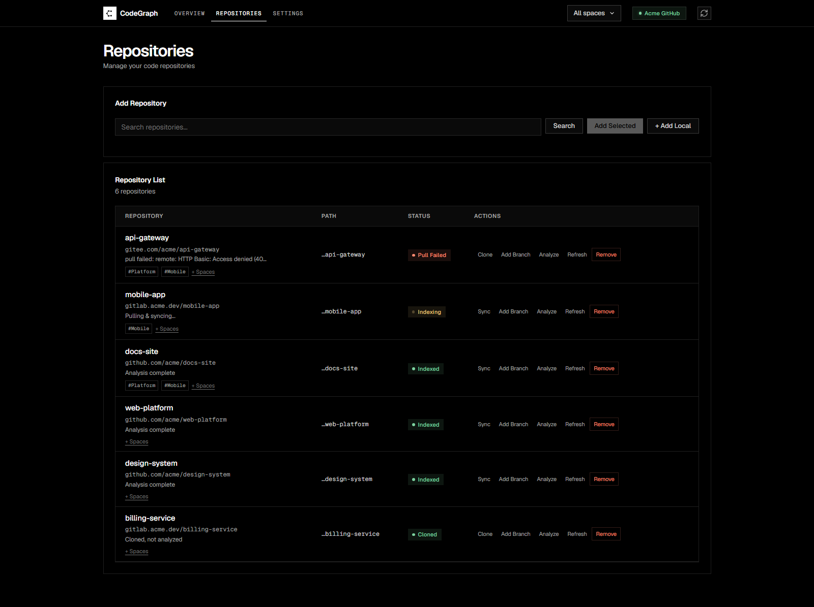
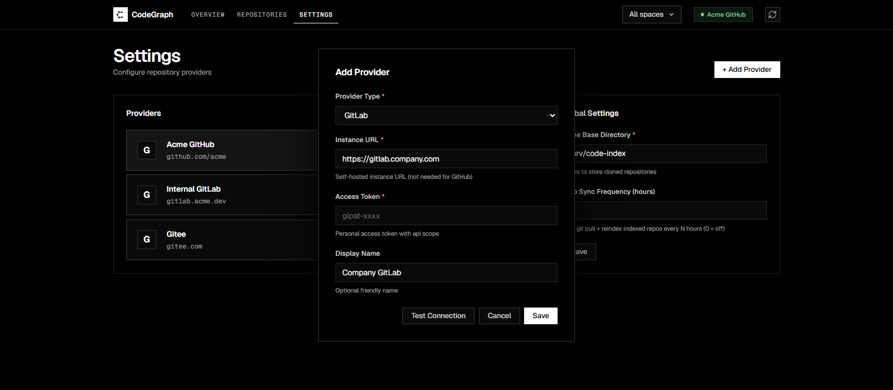
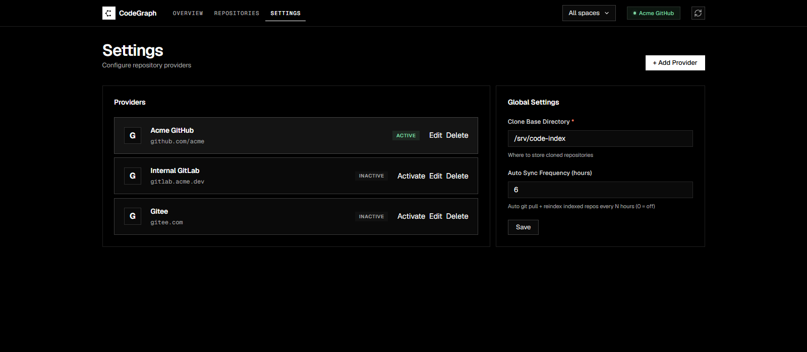

<div align="center">

# CodeGraph Manager

**把整个代码库变成 AI 能读懂的知识图谱。**

统一管理 GitLab / Gitee / GitHub 仓库，自动用 [CodeGraph](https://github.com/colbymchenry/codegraph) 构建代码知识图谱，
通过 **MCP（Model Context Protocol）** 让 Cursor、Claude 等 AI 代理直接检索你的代码。

[](https://nodejs.org)
[](#-依赖)
[](#-license)
[](#-mcp-接入)

🇨🇳 中文 · <a href="README.en.md">🇬🇧 English</a>

</div>

---

零依赖 Node 后端 + 单文件原生 JS 前端，**一条命令启动**：无需数据库安装、无需构建步骤、无需 Docker。
仓库 clone → 索引 → AI 检索全流程自动化，Token 加密落盘，数据一个目录全带走。

## ✨ 功能

**仓库管理**
- 多提供商统一管理 —— GitLab / Gitee / GitHub 多实例并存，跨源搜索一次出结果
- 全生命周期 —— `clone → analyze → sync → remove` 一键流转，浅克隆提速 10 倍级
- 本地仓库直纳 —— 已克隆目录直接注册，自动识别 Git 远程
- 多分支 worktree —— 按分支懒加载切出独立 worktree 并各建索引，AI 可检索任意分支；主索引自动豁免不污染
- 空间分组 —— 仓库打标签分组，界面按空间筛选
  - 新建空间：右上角 `All spaces → New Space`；分配仓库：仓库行 `+ Spaces`
- 定时保新鲜 —— 可配置周期自动 `git pull + sync`；拉取失败明确标记 `pull_failed`，不假装索引是最新的

**AI 检索（MCP）**
- 4 个 MCP 工具（Streamable HTTP / JSON-RPC 2.0），跨仓聚合检索：并发查所有已索引仓库，命中排序 + 每仓收敛，上下文不爆炸
- 首次检索未建索引的分支自动后台建索引，完成后即可用

**安全**
- 路由级鉴权 —— `/api/*` 与 `/mcp*` 分别持 `ADMIN_TOKEN` / `MCP_TOKEN`，`timingSafeEqual` 恒时比较
- 角色化访问令牌 —— Settings → Access tokens 创建 `web` / `mcp` token；web 只能查看/操作授权空间内的仓库，mcp 只能检索授权空间，admin 无限制
- 回环免鉴权 —— 本机访问默认放行（同源校验防网页打本地），对外开放时 fail-closed：无 token 拒绝启动
- 首启自动生成随机令牌（192bit）持久化到 `auth.json`，不用手动配也能安全对外开放
- Token 三重防护 —— 落盘 AES-256-GCM 加密、API 返回脱敏（掩码+末4位）、PUT 掩码不覆盖真值
- 请求体 1MB 上限（413）、跨源 Origin 一律 401、`X-Forwarded-For` 仅信可信代理

**工程化**
- SQLite 存储（`node:sqlite`，零 npm 依赖）—— 事务原子写，旧 JSON 首启自动迁移
- 三级并发治理 —— 全局索引队列限流 + 单仓生命周期互斥 + 每文件写串行，多仓并发不互踩
- 重启自愈 —— 中断的运行中状态自动重置；`CODEGRAPH_BIN` 自动探测，Windows 无需手配
- SSE 实时推送状态，30s 兜底轮询；`BASE_PATH` 支持反代子路径部署
- 内置回归脚本 `node verify-mcp.mjs`（49 项断言：协议合规 / 鉴权 / 脱敏 / 并发 / 迁移）

## 📸 界面

| 概览 | 仓库管理 |
|---|---|
|  |  |

| 添加提供商 | 设置 |
|---|---|
|  |  |

> 截图使用示例数据（Acme），不代表真实仓库内容。

## 🚀 快速开始

**一键安装**（自动装齐 Node → git → CodeGraph → cgm，已装的自动跳过）：

```bash
bash install.sh --port 8801          # Linux / macOS
.\install.cmd --port 8801            # Windows（或双击 install.cmd）
```

**手动安装**：

```bash
npm i -g @colbymchenry/codegraph     # 唯一外部依赖
npm i -g @kennyzhao/cgm              # 或在本仓库根目录 npm i -g .
cgm                                  # 任意目录一键启动
```

打开 **http://127.0.0.1:8801** → Settings 添加提供商 → Add Selected → Clone & Analyze，完成。

> CLI 参数优先级：命令行 > 环境变量 > 默认值。`cgm --port 9000 --data /srv/cgm-data`

## 🔌 MCP 接入

MCP 端点：`http://127.0.0.1:8801/mcp`（Streamable HTTP / JSON-RPC 2.0）

> UI 入口：**Settings → MCP access** 可直接复制 endpoint 与 `mcpServers` 客户端配置；本机生成无 header 版本，非 loopback 自动带 Bearer 占位。

**Cursor / Claude Desktop / Cline**（`mcpServers` 标准格式，本仓库附带 `mcp-config.json`）：

```json
{
  "mcpServers": {
    "cgm": {
      "url": "http://127.0.0.1:8801/mcp",
      "headers": { "Authorization": "Bearer <你的令牌>" }
    }
  }
}
```

> 本机访问默认免鉴权，`headers` 可省略。令牌从哪来：首次启动日志，或 `<DATA_DIR>/auth.json` 的 `adminToken`；也可用环境变量 `ADMIN_TOKEN` 显式指定。只能填 URL 的客户端可用 `?token=<令牌>` 兜底。

### 工具列表

| 工具 | 说明 |
|---|---|
| `query_repository(name)` | 按名查仓库：本地路径 / 状态 / 提供商 |
| `list_repositories(status?)` | 列出注册仓库，可按状态过滤 |
| `search_repositories(query)` | 模糊搜索仓库名 |
| `search_code(query, repo?, branch?, maxFiles?)` | **核心检索**：查 CodeGraph 知识图谱，返回符号 / 文件 / 调用关系。不传 `repo` 则跨所有已索引仓库聚合 |

按分支检索示例：

```json
{"jsonrpc":"2.0","id":1,"method":"tools/call",
 "params":{"name":"search_code","arguments":{"query":"AuthService loginUser","repo":"tineco-nmp","branch":"dev_ibu","maxFiles":12}}}
```

## ⚙️ 配置

| 变量 | 默认 | 说明 |
|---|---|---|
| `PORT` / `HOST` | `8801` / `127.0.0.1` | 监听地址；`HOST` 非回环时必须配 token（无则拒绝启动） |
| `DATA_DIR` | `<cwd>/data` | 数据目录（`cgm.db` + 克隆仓库默认存 `<DATA_DIR>/repos`） |
| `ADMIN_TOKEN` | 自动生成 | `/api/*` 令牌；未设置时首启生成随机值写入 `auth.json` |
| `MCP_TOKEN` | 回落 `ADMIN_TOKEN` | `/mcp*` 令牌（自用只配一个变量即可） |
| `LOCAL_NO_AUTH` | `1` | 回环免鉴权开关；设 `0` 本机也强制鉴权 |
| `BASE_PATH` | 空 | 反代子路径（如设 `/cgm` 后经 `/cgm/mcp` 访问） |
| `MAX_BODY_BYTES` | `1048576` | 请求体上限，超限 413 |
| `TRUSTED_PROXIES` | 空 | 逗号分隔可信代理 IP，仅对可信代理采信 `X-Forwarded-For` |
| `CODEGRAPH_BIN` | 自动探测 | CodeGraph 可执行（PATH 探测 → npm 全局 shim → 显式指定） |
| `SYNC_HOURS` | `6` | 定时同步周期（小时），`0` 关闭；UI Settings 可覆盖 |
| `QUEUE_CONCURRENCY` | `2` | 索引队列并发数 |
| `ENCRYPTION_KEY` | 自动生成 `.key` | 64 位 hex，AES-256-GCM 密钥 |

## 🔒 安全模型

| 场景 | 行为 |
|---|---|
| 本机 127.0.0.1 访问 | 默认免鉴权（开发/自用友好），跨源网页请求仍被 401 拦截 |
| 局域网 / 远程访问 | 必须持令牌（Bearer 头 / `?token=` / Cookie 任一） |
| `HOST=0.0.0.0` 且无令牌 | 启动时用自动生成的随机令牌兜底，日志打印令牌位置 |
| 令牌泄露面 | 落盘加密 + API 脱敏 + 首启仅日志打印一次 |

`data/` 已被 `.gitignore` 排除，真实 token 永不入库。对外开放建议叠加 Nginx 反代 + HTTPS（见 [DEPLOY-Linux.md](DEPLOY-Linux.md)）。

## 🔌 API 参考

| 端点 | 方法 | 说明 |
|---|---|---|
| `/healthz` | GET | 存活探针（无鉴权） |
| `/api/settings` | GET/PUT | 全局配置（返回值 token 已脱敏） |
| `/api/providers[/...]` | GET/POST/PUT/DELETE | 提供商 CRUD + 连接测试 + 跨源项目搜索 |
| `/api/repos[/local]` | GET/POST | 仓库注册表 / 添加本地仓库 |
| `/api/repos/:id/{clone,analyze,status,remove,sync}` | POST | 单仓操作（异步执行，同仓操作自动排队互斥） |
| `/api/repos/:id/worktree/:branch` | POST/DELETE | 分支 worktree 创建 / 删除 |
| `/api/spaces[/...]` | GET/POST/PUT/DELETE | 空间分组管理 / 仓库绑定 |
| `/api/tokens[/...]` | GET/POST/DELETE | 访问令牌管理（admin）：角色 + 空间范围 |
| `/api/browse?path=` | GET | 服务端目录浏览（添加本地仓库用） |
| `/mcp` · `/mcp/message` | POST/GET | MCP 端点（Streamable HTTP + SSE） |

## ❓ 常见问题

<details>
<summary><b>启动报 codegraph ENOENT？</b></summary>

Windows 全局安装的 codegraph 是 bash shim，PATH 直接 spawn 不通。本服务会自动探测并转成 `["node", "<shim>"]` 形式；老版本升级后无需再手配 `CODEGRAPH_BIN`。
</details>

<details>
<summary><b>配了 ADMIN_TOKEN 后前端一直 401？</b></summary>

页面会弹出令牌输入框，粘贴令牌即可（存浏览器 localStorage）。或清除 localStorage 里的 `cgm_token` 重新输入。
</details>

<details>
<summary><b>数据会丢吗？</b></summary>

所有数据在 `<DATA_DIR>` 一个目录（SQLite + 密钥 + auth.json），备份 = 拷贝目录。旧版 JSON 文件首启自动迁移，原文件改名 `*.json.migrated-*` 保留，删掉 `cgm.db*` 改回原名即可回退。
</details>

<details>
<summary><b>检索结果过时？</b></summary>

看仓库状态列：`pull_failed` 表示定时同步拉取失败（下轮自动重试）；也可手动点 Sync。索引基于 CodeGraph 增量 sync。
</details>

## 🛠 开发

```bash
git clone https://github.com/Zhao-T-X/CGM.git && cd CGM
node server.mjs                # 开发启动（127.0.0.1:8801）
node verify-mcp.mjs            # 回归测试：49 项断言（协议/鉴权/安全/并发/迁移）
```

```
cgm/
├── cli.mjs            CLI 入口（cgm 命令）
├── server.mjs         HTTP 后端（路由鉴权、提供商/仓库/空间、SQLite 持久化）
├── mcp.mjs            MCP 模块（4 工具 + CodeGraph stdio 网关客户端）
├── verify-mcp.mjs     回归脚本（49 项断言，临时实例隔离运行）
├── public/index.html  前端单文件（Vercel 风深色 UI）
└── install.sh/.cmd    一键安装脚本
```

## 🚢 发布（维护者）

推送 `v*` tag 触发 GitHub Actions 自动发 npm（tag 与版本校验 → `npm pack --dry-run` → `npm publish --provenance`，需配置 `NPM_TOKEN`）。

```bash
npm version patch && git push --follow-tags
```

## 📄 License

MIT
