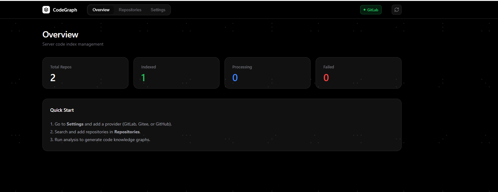
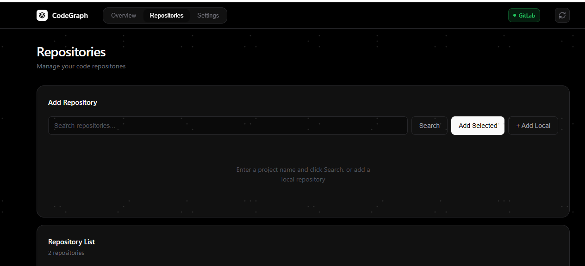
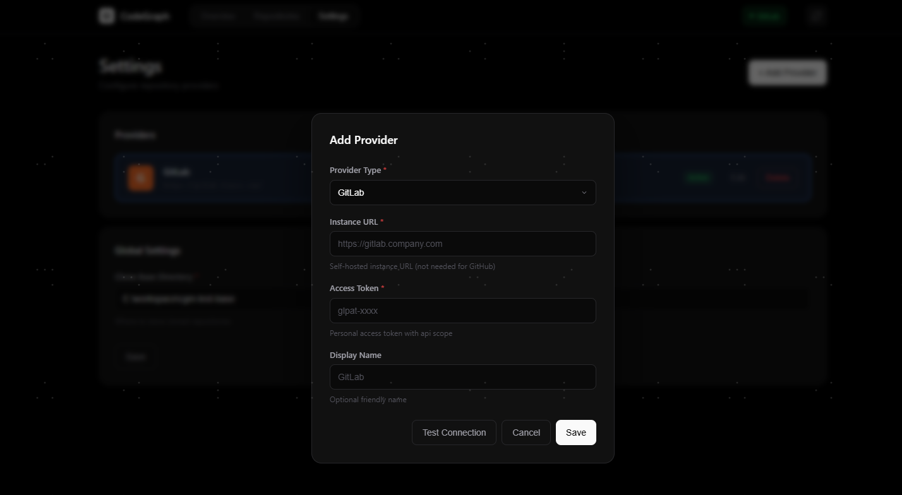
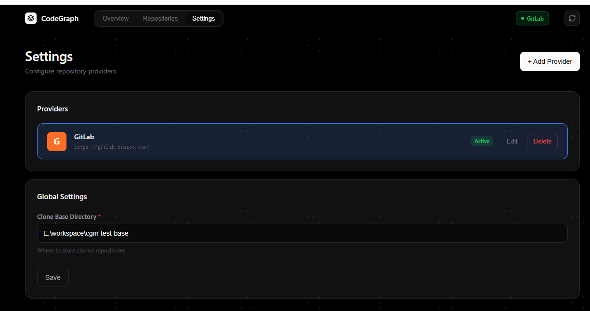

# CodeGraph Manager

<p align="center"><b>🇨🇳 中文</b> · <a href="README.en.md">🇬🇧 English</a></p>

服务器端代码索引管理服务——统一管理来自多个 Git 托管平台（GitLab / Gitee / GitHub）的仓库，自动克隆、用 [CodeGraph](https://github.com/colbymchenry/codegraph) 生成代码知识图谱，并通过 **MCP（Model Context Protocol）** 让 AI 代理直接检索代码。

**零依赖 Node 后端 + 原生 JS 前端**，单命令启动，无需数据库、无需构建。

## ✨ 功能

- **多提供商仓库管理**：一个界面统一管理 GitLab / Gitee / GitHub 三个平台的仓库（配置列表 + 弹窗新增，token 脱敏）
- **代码索引**：`clone → analyze → status → remove` 全流程，基于 CodeGraph 生成符号/文件/调用关系图谱
- **跨源搜索**：一次关键词搜索所有已配置的提供商，结果合并展示（带来源标签）
- **本地仓库支持**：直接纳入已克隆的本地目录（自动识别 Git 远程和分支）
- **多分支策略（worktree）**：每个仓库可按分支名懒加载切出独立 `git worktree` 并各自建索引；MCP `search_code` 传 `branch` 即检索该分支代码；主仓库 `.gitignore` 自动豁免 `worktrees/`，主索引不混入分支代码
- **异步懒加载**：首次检索某分支时若尚未建索引，后台自动 `fetch + worktree add + codegraph init`，立即返回"分支索引创建中，请稍后重试"，建好后即可检索；脏注册/残留目录自动自愈
- **仓库级联展示**：UI 主仓库行下展开各分支 worktree 子行（缩进 + 蓝色分支标识 + 独立状态），支持单独删除某分支 worktree
- **Token 加密存储**：提供商 token 以 AES-256-GCM 落盘加密（密钥 `ENCRYPTION_KEY` 或自动生成的 `.key`），内存明文，调用点无感
- **跨仓聚合检索**：`search_code` 不指定 repo 时并发检索所有已索引仓库，命中数排序 + 每仓收敛 + 总量 cap，避免上下文爆炸
- **启动自愈**：重启后中断的 `cloning/indexing/removing/syncing` 状态自动重置为可重试
- **定时同步**：Settings 页可配置自动同步频率（小时），0 关闭，保存即重建定时器
- **浅克隆提速**：`git clone --depth 1`（检索无需历史，clone 提速 10x 级），worktree 分支同样浅 fetch
- **索引限流队列**：codegraph init/sync 经全局队列限流（`QUEUE_CONCURRENCY`，默认 2），多仓并发不抢 CPU/IO，避免 SQLite db 锁竞争（EBUSY）
- **实时状态推送**：仓库状态变更经 SSE（`/mcp` 事件流）实时推送前端，30s 兜底轮询防连接僵尸
- **克隆健壮性**：clone 前清理残留目录，避免 `already exists` 失败
- **MCP 服务器**：`POST /mcp`（Streamable HTTP / JSON-RPC），暴露 4 个工具让 AI 检索代码
  - `search_code` —— 指定仓库（及可选分支）检索代码图谱（内部经 projectPath 映射调用 CodeGraph 原生 MCP）
- **CLI 一键启动**：`npm i -g .` 后任意目录 `cgm` 即起（`node cli.mjs` 等价）；`CODEGRAPH_BIN` 自动探测（PATH 里的 codegraph → npm 全局 shim），Windows 不再需要手配 JSON 数组
- **Vercel 风深色 UI**：纯黑底 + 极简留白 + 平滑动效

## 📸 界面截图

**概览（指标卡 + 顶部导航）**


**仓库管理（克隆 · 分析 · 移除）**


**添加提供商（弹窗选择平台 / Gitee / GitHub）**


**设置（提供商配置列表）**


## 🧰 MCP 工具

| 工具 | 说明 |
|---|---|
| `query_repository(name)` | 按仓库名查本地路径(projectPath)/状态/提供商 |
| `list_repositories(status?)` | 列出所有已注册仓库，可按状态过滤 |
| `search_repositories(query)` | 模糊搜索仓库名 |
| `search_code(query, repo?, branch?, maxFiles?)` | **检索代码**：repo→projectPath 映射后调用 CodeGraph 知识图谱，返回符号/文件/调用关系。传 `branch` 则在该分支的 worktree 索引上检索（首次自动后台建索引，返回"稍后重试"） |

示例调用（按分支检索）：
```json
{"jsonrpc":"2.0","id":1,"method":"tools/call","params":{"name":"search_code","arguments":{"query":"AuthService loginUser","repo":"tineco-nmp","branch":"dev_ibu","maxFiles":12}}}
```

> 多分支说明：仓库默认浅克隆（`--depth 1`，检索无需历史），主仓库索引只含默认分支；指定 `branch` 时后端自动 `git worktree add` 切出该分支并独立建索引，主索引通过 `.gitignore` 豁免 `worktrees/` 不被污染。

## 📦 依赖

| 组件 | 说明 |
|---|---|
| **CodeGraph** | `npm i -g @colbymchenry/codegraph`（MIT 许可） |

> 其余全部为 Node.js 内置模块（`http`/`fetch`/`child_process`），零额外依赖。

## 🚀 快速开始

### 1. 安装 CodeGraph
```bash
npm i -g @colbymchenry/codegraph
```

### 2. 启动服务（一键）
```bash
npm i -g codegraph-manager   # 方式一：安装 npm 发布版
npm i -g .                   # 方式二：在本项目根目录装成全局命令（效果同上）
cgm                          # 任意目录一键启动：自动探测 codegraph，零配置

# 不装全局的等价方式
node cli.mjs      # 或 node server.mjs / npm start
```

常用参数（优先级：命令行参数 > 环境变量 > 默认值）：
```bash
cgm --port 9000 --data /srv/cgm-data   # 自定义端口与数据目录
HOST=0.0.0.0 ADMIN_TOKEN=xxx cgm       # 对外开放（务必配 ADMIN_TOKEN）
```

> `CODEGRAPH_BIN` 无需手动配置：未设置时自动探测 PATH 里的 `codegraph`，探测不到再找 npm 全局包的 `npm-shim.js`（Windows bash shim 场景自动转 `["node", "<shim>"]` 形式）。仍可 `cgm --codegraph <bin>` 显式覆盖。

### 3. 访问界面
打开 **http://127.0.0.1:8801**

### 4. 配置提供商 & MCP
- **界面**：Settings → Add Provider → 选平台 → 填 URL/token → Save → Add Selected 仓库 → Clone/Analyze
- **MCP 客户端**（Cursor / Claude Desktop / 自定义 Agent）：
  ```
  远程 MCP 地址：http://127.0.0.1:8801/mcp
  ```
  或用项目内提供的 `mcp-config.json`（标准 `mcpServers` 格式）。

## ⚙️ 环境变量

| 变量 | 默认 | 说明 |
|---|---|---|
| `PORT` | `8801` | 监听端口 |
| `HOST` | `127.0.0.1` | 监听地址（`0.0.0.0` 对外开放，需配 `ADMIN_TOKEN` + 反代） |
| `DATA_DIR` | `<工作目录>/data` | 数据目录（`settings.json` 含提供商注册 + token，`repos.json` 仓库注册表；克隆仓库默认存于 `<DATA_DIR>/repos`） |
| `CODEGRAPH_BIN` | 自动探测 | CodeGraph 可执行：先探 PATH 里的 `codegraph`，再找 npm 全局包 `npm-shim.js`（Windows bash shim 自动转 `["node","<shim>"]`）。仍可显式指定：绝对路径或 JSON 数组形式 |
| `SYNC_HOURS` | `6` | 已索引仓库定时 `git pull + codegraph sync` 保新鲜（小时），`0` 关闭 |
| `QUEUE_CONCURRENCY` | `2` | 全局索引队列并发数（codegraph init/sync 限流） |
| `ADMIN_TOKEN` | — | 对外开放时 API 访问令牌 |

## 🚢 发布（维护者）

推送 `v*` tag 触发 GitHub Actions 自动发布到 npm（`publish` job：tag 与 `package.json` 版本一致性校验 → `npm pack --dry-run` 预览 → `npm publish --provenance`）。前提：仓库 Settings → Secrets and variables → Actions 配置 `NPM_TOKEN`（npmjs.com 生成的 Automation Token）。

```bash
npm version patch   # 或 minor / major：更新 package.json 并自动创建 tag
git push --follow-tags
```

## 🗂 目录结构

```
codegraph-manager/
├── cli.mjs            CLI 入口（cgm 命令：一键启动，参数 > env > 默认值）
├── server.mjs         零依赖 HTTP 后端（提供商 CRUD、仓库操作、/mcp 路由、静态服务）
├── mcp.mjs            MCP 服务器模块（4 工具 + CodeGraph stdio 网关客户端）
├── public/index.html  Vercel 风前端（single-file）
├── package.json       元数据（bin: cgm / npm start；private，零依赖）
├── DEPLOY-Linux.md    Linux systemd/systemd 部署说明
└── .gitignore         排除 data/ 敏感数据
```

## 🔌 API 参考

| 端点 | 方法 | 说明 |
|---|---|---|
| `/healthz` | GET | 存活探针（返回仓库数与运行时长，无鉴权） |
| `/api/settings` | GET/PUT | 全局配置（cloneBaseDir / activeProviderId / autoSyncHours） |
| `/api/providers` | GET/POST | 提供商列表（token 脱敏）/ 新增 |
| `/api/providers/:id` | PUT/DELETE | 更新 / 删除提供商 |
| `/api/providers/check` | POST | 测试连接（内存校验，不落盘） |
| `/api/providers/projects` | GET | 跨源搜索项目（`q=`+`providerId=all`） |
| `/api/repos` | GET/POST | 仓库注册表 |
| `/api/repos/local` | POST | 添加本地仓库 |
| `/api/repos/:id/{clone,analyze,status,remove,sync}` | POST | 仓库操作（clone/analyze/sync 立即返回，后台异步执行） |
| `/mcp` | POST(HTTP)/OAuth | MCP 端点（JSON-RPC 2.0，Streamable HTTP） |
| `/mcp/message` | POST | MCP SSE 消息端点 |

## 🔒 安全说明

- `data/` 已被 `.gitignore` 排除——**真实 GitLab/Gitee/GitHub token 只存服务端数据目录，永不提交到 git**
- `.gitignore` 仅排除运行时数据，源码完整入库
- 服务默认仅监听 `127.0.0.1`；对外开放需 `HOST=0.0.0.0` + `ADMIN_TOKEN` + Nginx 反向代理（见 `DEPLOY-Linux.md`）
- MCP 端点无认证（本机服务）——仅限可信网络使用

## 🤝 用途

适合把公司内网多个代码平台（GitLab 等）的仓库统一索引，供 AI 编码代理（Cursor、Claude Code、Hermes 等）通过 MCP 检索代码，实现跨仓库的符号定位、调用关系分析和影响范围评估。

## 📄 License

MIT（CodeGraph 为 MIT；本项目原生代码可按需选择许可）。